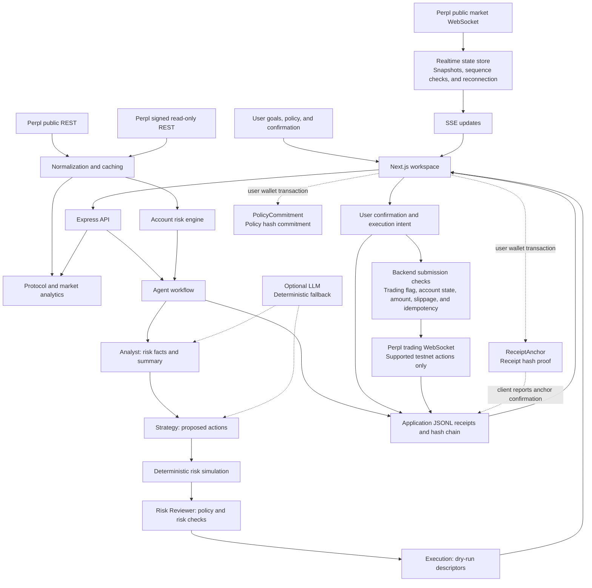

<h1 align="center">AssetPilot</h1>

<p align="center"><strong>Give AI trading clear boundaries, evidence, and a traceable record.</strong></p>

An AI trading risk-control and audit prototype for Perpl / Monad testnet, bringing real-time market data, account risk, strategy simulation, deterministic review, and optional onchain proofs into one inspectable workflow.

## Background and Pain Points

### Background

As AI agents move from answering questions to proposing trades, users need to assess more than whether a recommendation sounds reasonable. They need to know whether the agent has sufficient market context, understands the account's existing risk, respects the user's authorization, and leaves a record that can be reviewed later.

AssetPilot addresses this trust problem in onchain perpetual trading. Using Perpl market and account data, it places explainable risk analysis, configurable policy boundaries, and verifiable audit records between an agent's recommendation and order submission. Users can inspect before execution, control what is authorized, and trace the recorded process afterward.

### Pain Points

- **Fragmented risk information makes action difficult to assess.** Prices, funding rates, order books, positions, and historical PnL come from different endpoints. Users must piece together leverage, concentration, and collateral usage themselves.
- **AI recommendations lack clear execution boundaries.** A plausible suggestion may exceed allowed accounts, markets, action types, amounts, or slippage limits. Users also need a way to compare risk before and after a proposed action.
- **Decisions and execution are difficult to review.** Without linked records of proposals, review, confirmation, and submission, users cannot easily reconstruct which data informed a decision, which policy applied, or exactly what they confirmed.

## Solution

AssetPilot provides a Trade Guard workspace. Users define a risk-management goal and policy limits; the system reads Perpl data, proposes actions, simulates risk changes, and applies deterministic rules to approve, request revision, or reject the strategy. After approval, users can inspect an execution preview and, when the required configuration and checks permit it, submit a testnet action.

### Core Innovations

| Innovation | Implementation | User Value |
| --- | --- | --- |
| AI proposes; rules review | Analyst organizes risk facts, Strategy proposes actions, Risk Reviewer independently applies code-defined checks, and Execution prepares dry-run descriptors | The LLM cannot override the deterministic review decision |
| Compare risk before execution | Deterministic simulation of reductions, closures, cancellations, and hypothetical collateral additions, comparing scores, exposure, estimated effective leverage, and concentration | Users can inspect expected risk effects and simulation assumptions before confirming |
| Visible data quality | Sources, update times, estimates, missing fields, and score coverage are surfaced; insufficient coverage can produce `unknown` or a request for more data | Users can distinguish available evidence from incomplete information |
| Audit records with optional onchain proofs | Canonical JSON, SHA-256 hashes, and previous-hash links connect application receipts; `PolicyCommitment` commits policy hashes and `ReceiptAnchor` anchors receipt hashes | Decisions can be exported and checked, with optional user-signed proof transactions |

Analysis and strategy generation can fall back to deterministic logic when no LLM is configured, a model call fails, or its output fails the relevant validation. The core workflow can therefore be explored without a model API key.

**Responsibility boundary:** Policy checks run in the backend before order submission. The two contracts record compact hash proofs; they do not execute Perpl orders, custody funds, or enforce risk policies onchain. Full policies and receipts remain at the application layer. Perpl order IDs and onchain proof transaction hashes are displayed as separate identifiers.

### User Stories and Scenarios

**Scenario 1: Understand the market before trading.** Without configuring API credentials, a user can open Overview and Markets to inspect volume, estimated open interest, TVL, funding, price history, and order books, alongside realtime connection and data-availability indicators.

**Scenario 2: Review ways to reduce existing exposure.** After configuring read-only credentials, a user checks exposure, concentration, and historical performance in Wallet, then enters “Reduce current risk without increasing exposure” in Trade Guard. The system proposes reductions, closures, cancellations, or holding based on account state and policy, and displays simulation results and review reasons. Rejected or revision-required plans need another run; approved plans can proceed to inspection and confirmation.

**Scenario 3: Review an agent decision.** In Receipts, a user filters by type, decision, or execution status, inspects individual records and the hash chain, and exports JSON. With anchoring enabled, the user can submit a receipt hash to Monad testnet through a wallet and record its proof transaction information.

## Technical Architecture

### Technology Stack

| Layer | Technology | Purpose |
| --- | --- | --- |
| Frontend | Next.js 14 App Router, React 18, TypeScript | Landing page, analytics dashboards, Trade Guard, and receipt browser |
| UI and visualization | Tailwind CSS, Recharts, Lucide React | Risk indicators, charts, order books, and status displays |
| Data queries | TanStack Query, browser EventSource | REST queries, caching, polling, and SSE updates |
| Backend | Node.js, Express, TypeScript, tsx | API orchestration, normalization, risk, and execution services |
| Data integration | Perpl public REST, Ed25519-signed read-only REST, public market WebSocket, trading WebSocket | Market and account data, plus guarded testnet submission |
| Risk calculations | decimal.js, deterministic scoring and simulation | Decimal arithmetic, exposure and performance calculations, and strategy review |
| Model integration | Optional LLM provider supporting Chat Completions / Responses-style interfaces | Risk summaries and strategy candidates with deterministic fallback |
| Audit storage | Append-only JSONL, SHA-256 hash chain, optional independent Ed25519 signing | Receipt persistence, integrity verification, and export |
| Onchain proofs | Solidity 0.8.24, Foundry, viem, MetaMask / EIP-1193 wallets | Policy commitments and receipt anchoring on Monad testnet |
| Verification | Node.js Test Runner, Foundry, ESLint | Backend unit and API tests, contract tests, and frontend static checks |

### Architecture Diagram



The backend shares a public market WebSocket and forwards updates to the frontend through SSE. Order books start from snapshots. Where sequence numbers are present, duplicates and gaps are checked; gaps trigger REST resynchronization. Frontend REST polling continues during connection failures, and the UI displays degraded states.

### Project Structure

```text
AssetPilot/
├── frontend/                 # Landing page, analytics, Trade Guard, receipts
├── backend/
│   ├── src/perpl/            # REST, realtime data, analytics, trading
│   ├── src/risk/             # Risk metrics, scoring, simulation
│   ├── src/agents/perpl/     # Agent workflow and deterministic review
│   ├── src/receipts/         # Receipt construction, storage, signing, verification
│   └── scripts/              # Perpl module checks
├── contracts/                # Proof contracts, tests, deployment scripts
├── deployments/              # Deployment metadata templates
└── docs/                     # Architecture, methodology, data, security, demo
```

## Quick Start

### 1. Start the Local Services

Use Node.js 22.15+ or 24 and npm, with access to the configured Perpl testnet endpoints. The realtime and trading clients use Node.js's global `WebSocket`. Viewing markets and running dry-runs do not require deployed contracts or MetaMask.

From the repository root, start the backend:

```bash
cd backend
npm ci
cp -n .env.example .env
npm run dev
```

In a second terminal, also starting from the repository root, start the frontend:

```bash
cd frontend
npm ci
cp -n .env.example .env.local
npm run dev
```

`cp -n` preserves existing environment files. The frontend defaults to [http://localhost:3000](http://localhost:3000), and the backend to [http://localhost:8787](http://localhost:8787). If you change ports, update frontend `NEXT_PUBLIC_API_BASE_URL` and backend `PERPL_ALLOWED_FRONTEND_ORIGINS` accordingly.

| Route | Experience | Requirements |
| --- | --- | --- |
| `/` | Product introduction | None |
| `/overview` | Protocol metrics, market distribution, trends, and data quality | Available Perpl public endpoints |
| `/markets`, `/markets/[marketId]` | Market screening, details, funding, and order books | Available public endpoints; use an actual market ID |
| `/wallet` | Accounts, positions, orders, fills, risk, and performance | Backend read-only credentials |
| `/trade-guard` | Goal and policy editing, Agent analysis, manual simulation, and review | Backend read-only credentials; LLM optional |
| `/receipts` | Receipt filtering, details, verification, JSON export, and optional anchoring | Run an Agent workflow through the application to generate a receipt |

### 2. Explore Account Risk and Agent Dry-Runs

Set a valid pair of Perpl testnet read-only credentials in `backend/.env`, keeping trading disabled:

```dotenv
PERPL_READ_API_KEY=<your-read-only-api-key>
PERPL_READ_API_KEY_SECRET=<corresponding-ed25519-secret>
PERPL_TRADING_ENABLED=false
```

Restart the backend, inspect account risk at `/wallet`, then open `/trade-guard`:

1. Enter a risk-management goal and review allowed accounts, markets, and actions.
2. Set amount, leverage, slippage, reduction, expiry, and simulation constraints.
3. Click **Run analysis** to inspect findings, proposals, before/after simulation, and the review decision.
4. Open `/receipts` to inspect the generated `risk_review`, verify its hash and chain, and export JSON.

Without open positions, the system may recommend holding. Insufficient data coverage can require clarification or block a recommendation. A dry-run does not submit orders, and approval still requires user confirmation before further action.

For model assistance, configure `LLM_API_KEY`, `LLM_MODEL`, `LLM_BASE_URL`, and `LLM_API_STYLE` in `backend/.env`. Supported styles are `chat_completions` and `responses`. Supply nonempty model and base-URL values when enabling the model; leave the API key empty to use deterministic fallback.

Keep all Perpl API credentials in backend environment files. Never place them in frontend code or `NEXT_PUBLIC_*` variables.

### 3. Optional: Testnet Order Submission

Configure independent `PERPL_TRADE_API_KEY` / `PERPL_TRADE_API_KEY_SECRET` credentials and set `PERPL_TRADING_ENABLED=true`. The current submission path accepts exactly one approved reduction, closure, or cancellation. Accounts must allow forwarding and be unfrozen, and the applicable policy and server checks must pass.

In Trade Guard, confirm the plan, prepare an execution intent, inspect the order preview, then type `SUBMIT TESTNET ORDER` to submit. Example server defaults cap order notional at 100 USD, leverage at 5, and slippage at 50 bps. Align the frontend policy with these limits.

**Known limitation:** Agent/simulator reduction fractions and order-builder percentages currently use inconsistent units. Do not present a reduction submission as matching its simulation until this is corrected and verified. See the [demo script](docs/DEMO_SCRIPT.md) for the exact behavior and submission-result branches.

### 4. Optional: Policy Commitments and Receipt Anchoring

Prepare MetaMask or another EIP-1193 wallet, Monad testnet MON, and deployed contract addresses. See the [contract guide](contracts/README.md) for testing and deployment.

Enable the desired features in `frontend/.env.local`:

```dotenv
NEXT_PUBLIC_ANCHOR_CHAIN_ID=10143
NEXT_PUBLIC_ANCHOR_CHAIN_NAME=Monad Testnet
NEXT_PUBLIC_ANCHOR_RPC_URL=https://testnet-rpc.monad.xyz
NEXT_PUBLIC_POLICY_COMMITMENT_ENABLED=true
NEXT_PUBLIC_POLICY_COMMITMENT_ADDRESS=<deployed-policy-commitment-address>
NEXT_PUBLIC_ANCHORING_ENABLED=true
NEXT_PUBLIC_RECEIPT_ANCHOR_ADDRESS=<deployed-receipt-anchor-address>
```

Restart the frontend, then click **Commit policy onchain** in Trade Guard or select a receipt and click **Anchor onchain** in Receipts. The wallet signs and submits the proof transaction. After the browser confirms an anchor transaction and reports it, the application appends a separate `anchor_confirmation`, preserving the original receipt and its hash.

### 5. Verification and Troubleshooting

From the backend directory, run automated checks or inspect external integrations:

```bash
npm test
npm run build
npm run perpl:check
npm run perpl:analytics-check
npm run perpl:agent-check
npm run perpl:trade-check
npm run perpl:receipt-check
npm run perpl:realtime-check
```

Requirements differ across `perpl:*` commands: market checks require network access; Agent checks require read-only credentials. `perpl:trade-check` inspects trading capabilities and does not submit orders. Use `/api/system/status` for configuration and module state, and the relevant check for troubleshooting. A configured service is not proof of external connectivity.

In `frontend/`, run `npm run lint` and `npm run build`. For contracts, install Foundry, then run `forge build` and `forge test` from the repository root. The required [minimal forge-std compatibility layer](contracts/lib/forge-std/README.md) is included in the repository; no separate library installation or submodule setup is needed. Foundry may download Solidity 0.8.24 on first use. The [demo script](docs/DEMO_SCRIPT.md) also explains receipt-store paths and other setup details.

## Results

### Current Project Status

**A locally runnable testnet MVP with implementations for data analysis, strategy simulation and review, optional guarded submission, and audit proofs.**

| Module | Implemented Capabilities |
| --- | --- |
| Market data and analytics | Perpl public REST, signed read-only REST, market WebSocket, and SSE; market screening, 24h / 7d / 30d analysis, price/funding history, book depth, and availability indicators |
| Account risk | Position exposure, effective leverage estimates, concentration, locked-balance ratio, funding-related risk, historical PnL/drawdown metrics, score coverage, and missing-data warnings |
| Agent and simulation | Analyst → Strategy → Risk Reviewer → Execution workflow, deterministic fallback, before/after risk comparison, approve / revise / reject decisions, and dry-run descriptors |
| Trade Guard | Policy editing, user confirmation, execution intents, order previews, testnet trading flag, account/order checks, idempotency keys, and receipt links |
| Audit receipts | Append-only JSONL, SHA-256 hash chain, individual and chain verification, paginated filtering, JSON export, and an optional independent signing path |
| Onchain proofs | `PolicyCommitment` and `ReceiptAnchor` Solidity contracts, tests, deployment scripts, frontend wallet interactions, and anchor-confirmation receipts |
| Product and documentation | Landing page, Overview, Markets, market details, Wallet, Trade Guard, Receipts, and supporting architecture, methodology, data, security, and demo documents |

### Verified Results

Existing checks were run locally on October 13, 2026:

- Backend `npm test`: **67 tests passed**, covering data access, signing, precision, analytics, risk simulation, Agent review, trading restrictions, and receipts.
- Contracts `forge test`: **10 tests passed**, covering commitments, receipt anchors, events, and invalid/duplicate submissions.
- Frontend `npm run lint`: **no warnings or errors**.

Backend tests mock external calls; contract tests run in a local EVM. These results do not establish successful live Perpl trading, a verified public deployment, or production performance.

### Current Boundaries and Remaining Work

The implementation targets a testnet demonstration with one backend-configured credential set. Workflows and intents are stored in process memory; restarting requires fresh analysis and confirmation. Current reconciliation records saved submission results rather than independently matching external fills and positions. The frontend waits for proof transaction confirmation, but the backend anchor-registration endpoint does not independently verify onchain transactions or events.

Some metrics remain unavailable, including protocol active users, revenue, net flows, historical OI/TVL, and position liquidation prices/distances. Simulation does not forecast future fees, funding, slippage, or execution-price changes. The reduction-unit mismatch, authentication and durable execution controls, and raw historical PnL/fee units need further work, as detailed in the supporting documents. The project does not yet establish production readiness, improved returns, or reduced live-trading risk.

Further reading: [Architecture](docs/ARCHITECTURE.md) · [Data Sources](docs/PERPL_DATA_SOURCES.md) · [Risk Methodology](docs/RISK_METHODOLOGY.md) · [Security](docs/SECURITY.md) · [Demo Script](docs/DEMO_SCRIPT.md)

License: [MIT](LICENSE).
