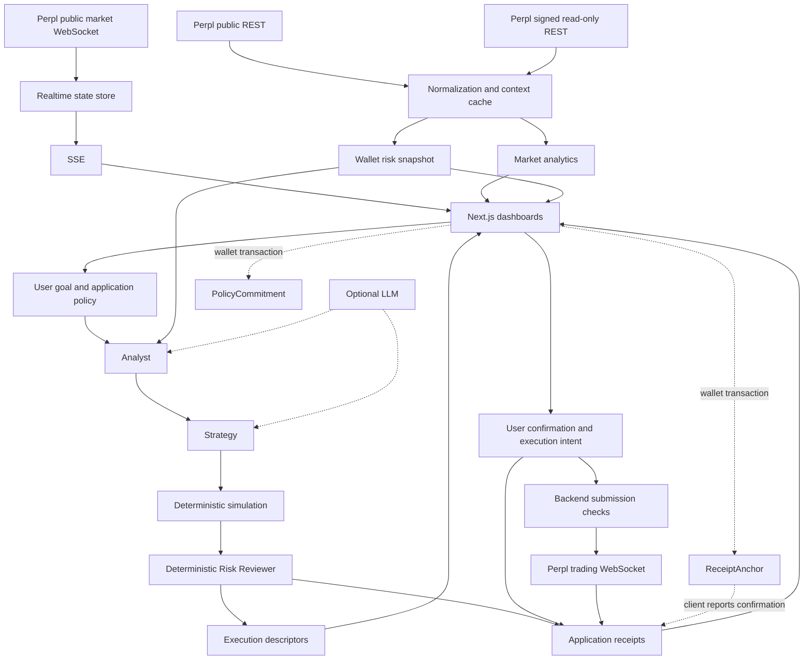

# AssetPilot Architecture

AssetPilot is a local testnet MVP for Perpl market intelligence, account risk analysis, Agent strategy review, and application-level audit receipts. Its optional proof contracts run on Monad testnet (chain ID `10143`).

## Components and responsibilities

| Component | Implementation | Responsibility |
| --- | --- | --- |
| Web application | Next.js 14, React 18, TanStack Query, Recharts | Landing page, analytics, wallet risk, Trade Guard, and receipt browser |
| API server | Express and TypeScript | Data access, workflow orchestration, confirmation, and execution endpoints |
| Perpl data layer | Public REST and Ed25519-signed read-only REST | Market context, account state, and historical data |
| Realtime service | Shared public WebSocket, in-memory state, SSE | Public ticker, funding, and order-book updates |
| Risk and analytics | decimal.js and deterministic calculation modules | Exposure, performance, risk scores, market metrics, and simulations |
| Agent workflow | Analyst, Strategy, Risk Reviewer, Execution | Propose actions, simulate them, review policy, and prepare dry-run descriptors |
| Trading service | Separate authenticated trading WebSocket | Optional server-guarded testnet submission |
| Receipt service | Append-only JSONL and SHA-256 hash links | Record, list, verify, and export workflow evidence |
| Proof contracts | `PolicyCommitment` and `ReceiptAnchor` | User-submitted policy commitments and receipt hash anchors |

## Data and execution flow

The Agent endpoint accepts `mode: "dry_run"`. Running analysis produces descriptors, not submitted orders, calldata, or signatures. Optional LLM calls can supply a summary and strategy candidate; deterministic logic provides a fallback, and the Risk Reviewer owns the approval decision.

Trade Guard separates local approval, backend workflow confirmation, intent preparation, and explicit submission. Intent creation requires exactly one approved `reduce_position`, `close_position`, or `cancel_order` action. The backend refreshes wallet, position, order, and market inputs when preparing its order preview, then applies capability and server-limit checks before submission. See [security boundaries](SECURITY.md) for checks that are not yet comprehensive.

## Realtime behavior

The backend shares a public connection at `${PERPL_WS_URL}/ws/v1/market-data` across subscriptions. It serves browser clients through:

- `GET /api/perpl/realtime/stream?markets=&channels=`
- `GET /api/perpl/realtime/status`

Subscriptions retain references to the required streams. The service loads REST market context and requested order-book snapshots before connecting. Order-book deltas require a base snapshot; zero-order updates remove price levels. Where `sn` is provided, duplicate or older ticker, funding, and book messages are ignored, while gaps trigger stale marking and REST resynchronization. Unsequenced messages have no strict ordering guarantee.

The service implements reconnect backoff, heartbeat sending, and stale detection. Frontend REST queries continue polling independently when SSE or WebSocket updates fail. `PERPL_REALTIME_REST_RESYNC_MS` is parsed into configuration but is not currently wired to a periodic backend resync timer. Do not describe it as a guaranteed refresh interval.

## Receipts and persistence

The receipt service stores normalized, redacted records in JSONL. It hashes canonical JSON with SHA-256, excluding `receiptHash` and `signature`, and links records through `previousReceiptHash` and optional `parentReceiptId`. Initialization checks stored hashes, sequence numbers, and chain links. Independent Ed25519 receipt signing is optional.

| Event | Current receipt behavior |
| --- | --- |
| Agent run | Attempts to append `risk_review`; the response reports whether saving succeeded |
| Backend workflow confirmation | Appends `user_confirmation` when the required receipt path is available |
| Intent creation | Appends `execution_intent` |
| Accepted or rejected submission response | Appends `order_submission`; rejection also appends `order_finalized` |
| Timeout or disconnection result | Appends `order_update` with `currentStatus: "unknown"` |
| Manual reconciliation | Records the stored submission result in `reconciliation` |
| Client reports an anchor transaction | Appends `anchor_confirmation` without modifying the original receipt |

An accepted response means Perpl accepted the request for forwarding, not that the order filled. The current reconciliation method does not fetch external orders, fills, or positions, even though its receipt metadata lists those sources. There is no complete automated order-to-fill reconciliation loop.

Workflows, confirmations, execution intents, and realtime state are in memory. Restarting the backend loses those objects; JSONL receipts remain. The configured receipt path is relative to the backend process's working directory. See [demo setup](DEMO_SCRIPT.md) before changing an existing store location.

## Optional onchain proofs

`PolicyCommitment.commitPolicy(policyHash, expiresAt)` records a nonzero policy hash for a submitter with a future expiry. Duplicate commitments for the same submitter and hash revert. The frontend obtains the canonical policy hash from the backend, submits through an EIP-1193 wallet, and waits for transaction success. Its commitment state is local to the component and becomes stale when policy edits change the local snapshot. The backend workflow does not require or independently validate this proof. `isCommitted` reports that a record exists; it does not test whether its expiry has passed.

`ReceiptAnchor.anchorReceipt(...)` stores the receipt hash, workflow hash, previous receipt hash, receipt type, submitter, and timestamp. Duplicate receipt hashes revert. The frontend uses SHA-256 receipt hashes and a Keccak-256 hash of the workflow ID for the contract's `workflowHash` field. That field is distinct from the application's execution `planHash`.

The browser waits for a successful transaction receipt before reporting anchor metadata. The backend registration endpoint validates metadata formats and appends an `anchor_confirmation`; it does not independently query the transaction, contract, or event. Its displayed anchored status is therefore application-recorded status, not a server-verified chain attestation.

Both contracts store compact proofs. Full policy and receipt JSON remain offchain. Neither contract executes Perpl orders, holds funds, or enforces risk limits. `onchainEnforced` stays `false`; original receipts keep `onchainAnchored: false`, while a separate anchor-confirmation record carries the anchor information.

## Routes and status

Frontend routes are `/`, `/overview`, `/markets`, `/markets/[marketId]`, `/wallet`, `/trade-guard`, and `/receipts`.

Backend groups cover public and private data under `/api/perpl/`, analytics, `/risk`, `/risk/simulate`, `/policy/hash`, `/agent/run`, `/workflows/:workflowId/confirm`, `/trading/capabilities`, `/execution/intents`, `/receipts`, and `/realtime`.

`GET /health` checks the process. `/api/perpl/health` reports configuration. `/api/system/status` combines configuration flags, current realtime state, static module availability, and receipt-store verification. It does not probe every external service, validate model connectivity, or verify deployed contract bytecode. A configured REST or RPC URL does not establish connectivity.

## Implementation references

- [API routes and orchestration](../backend/src/server.ts)
- [Perpl services](../backend/src/perpl/service.ts) and [realtime service](../backend/src/perpl/realtime/realtimeService.ts)
- [Agent workflow](../backend/src/agents/perpl/orchestrator.ts) and [trading service](../backend/src/perpl/trading/executionService.ts)
- [Receipt service](../backend/src/receipts/receiptService.ts)
- [Risk methodology](RISK_METHODOLOGY.md) and [data sources](PERPL_DATA_SOURCES.md)
